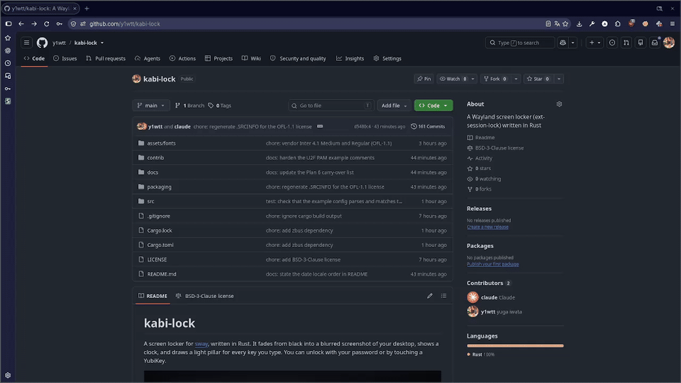

# kabi-lock

[English](README.md) | 日本語

Rust で書いた [sway](https://swaywm.org/) 向けの画面ロッカーです。
ロックすると、黒からデスクトップのスクリーンショットをぼかしたものへフェードインし、時計を表示して、
キーを打つたびに光の柱を立ち上げます。パスワードでも、YubiKey のタッチでも解除できます。



*sway でロックしてから解除するところ。*

## 特徴

- `ext-session-lock-v1` で、すべてのモニターのセッションをロックします。
- 背景は、ロックの直前に撮ったスクリーンショットです。ぼかし、周辺を暗くし、黒からフェードインします
  （初期値は 1.5 秒）。解除するとぼかしが晴れます。
- 1 つのモニターに、時計・日付・16 レーンの入力の帯を表示します。キーを押すたびに、空いているレーンの
  どれかに光の柱が立ち上がります。Backspace でも立ち上がります。Esc と Ctrl+U は入力を消し、柱は出しません。
- Enter を押すと錠が現れます。成功すると開き、失敗すると震えます。
- パスワードは PAM で確かめます。YubiKey のタッチ（`pam_u2f`）でも、パスワードの入力と並行して解除できます。
- KeePassXC 連携（任意）: 画面をロックする前にデータベースをロックし、解除した後に解除のダイアログを
  出すよう頼みます。
- ロック中にモニターを抜き挿しできます。新しく挿したモニターにも、ロックした（黒い）画面を出します。
- GPU が使えなくても、無地の黒い画面でロックします。
- 設定は TOML です。どの設定も省略できます。


*打つと光の柱が立ち上がり、パスワードを間違えると錠が震えます。*

## 必要なもの

- `ext-session-lock-v1` が使える Wayland コンポジター。sway で開発・確認しています
  （sway 1.8 以降に `ext-session-lock-v1` があります）。
- 任意: `wlr-screencopy-unstable-v1`（sway にあります）。スクリーンショットの背景に使います。
  ない場合、背景は黒になり（警告をログに出します）、ロックには影響しません。
- EGL と OpenGL ES 3 が使える GPU ドライバー（Mesa など）。ない場合は黒い画面で代わりにロックします。
- PAM、libxkbcommon、libwayland。
- `auth` と `account` の両方の行がある `/etc/pam.d/kabi-lock` サービスファイル（Arch のパッケージが
  入れます。[インストール](#インストール)を参照）。`auth.pam_service` で指定した PAM サービスのファイルが
  `/etc/pam.d` にも `/usr/lib/pam.d` にもなければ、kabi-lock はロックを取りません。
- 任意: sway の IPC ソケット（`SWAYSOCK`。sway が子プロセスに設定します）。ロックを始めたときに
  フォーカスしていたモニターを知るために使います。ない場合は最初のモニターを使います。
- 任意: fontconfig。Arch のパッケージでは依存として入ります（ソースから作るときは任意）。
  `fc-list` で `appearance.font` のフォントを探し、`fc-match` で時刻のロケールの言語の日付の字形に
  使う代わりのフォントを探します。kabi-lock がこれらを待つのは最大で約 1 秒です。
  fontconfig がない（または時間切れの）ときは、時計と日付は内蔵の Inter になり、ラテン文字以外の
  曜日や月の名前は空の四角で表示されることがあります。
- 任意: [`pam_u2f`](https://developers.yubico.com/pam-u2f/)。YubiKey で解除するときに使います。
- 任意: Secret Service 連携を有効にした KeePassXC。KeePassXC 連携に使います。
- ビルドに: Rust 1.95 以降（egui 0.37 が要求します）、`git`、`clang`（`pam-sys` クレートが bindgen を動かします）。

## インストール

### Arch Linux

```sh
mkdir kabi-lock-build && cd kabi-lock-build
curl -O https://raw.githubusercontent.com/y1wtt/kabi-lock/main/packaging/arch/PKGBUILD
makepkg -si
```

最新の `main` をビルドして、バイナリ、`/etc/pam.d/kabi-lock`、ライセンス、文書、
`/usr/share/kabi-lock/` の下の例を入れます。

### ソースから

```sh
git clone https://github.com/y1wtt/kabi-lock.git
cd kabi-lock
cargo build --release --locked
sudo install -Dm755 target/release/kabi-lock /usr/local/bin/kabi-lock
sudo install -Dm644 packaging/pam.d/kabi-lock /etc/pam.d/kabi-lock
```

フォント（Inter）はバイナリに組み込まれています。PAM のファイルは必須で、`auth` と `account` の
両方の行が要ります（[パスワード](#パスワード)を参照）。`/etc/pam.d/kabi-lock` がなければ kabi-lock は
ロックを取らず、`auth` だけのファイルではどのパスワードも通りません。自分を締め出さないよう、
試す前に作っておいてください。

手でコピーした `/etc/pam.d/kabi-lock` は、どのパッケージのものでもありません。後で Arch のパッケージを
入れるときは、先にそのファイルを消してください。消さないと `pacman -U` が "exists in filesystem" で失敗します。

sway が使う `PATH` に `kabi-lock` がなければ、キーの割り当てにフルパスを書いてください。

## 使い方

sway の設定にキーの割り当てを足します（`contrib/sway/kabi-lock.conf` を参照）:

```
bindsym $mod+l exec kabi-lock
```

sway の初期設定では `$mod+l` がすでに「右へフォーカス」に使われているので、どちらかを変えてください。
あとは `$mod+l` を押します。パスワードを打って Enter を押すか、YubiKey に触れてください。

| キー | 動作 |
|---|---|
| Enter | パスワードを確かめる |
| Backspace | 1 文字消す |
| Esc、Ctrl+U | 入力を消す |

`kabi-lock` は引数なしで起動します。オプションは `--help` と `--version` だけです。
ログは標準エラーに出ます。初期のレベルは `warn` で、`RUST_LOG=debug` にすると詳しく出ます。
メッセージにパスワードやその長さが含まれることはありません。

| 終了コード | 意味 |
|---|---|
| 0 | 解除して、正常に終了した |
| 1 | ロックできなかった（`ext-session-lock-v1` がない、要求が断られた、Wayland に接続できない、PAM サービスのファイルがない、ユーザー名が分からない）、またはコンポジターが確立したロックを終わらせた（"the compositor ended the lock"） |
| 2 | 引数が正しくない |

本物のセッションをロックせずに試すには、入れ子の sway を起動して
（`WLR_BACKENDS=wayland sway -c nested.conf`。`nested.conf` に `exec kabi-lock && swaymsg exit` と書く）、
その中で動かします。解除すると `kabi-lock` は 0 で終了し、入れ子の sway も終わります。
ロックに失敗したときは入れ子の sway が開いたままになるので、そのウィンドウを閉じてください。

アイドル時やサスペンド時の連携は kabi-lock には含まれません。`kabi-lock` は解除するまで
フォアグラウンドで動き続けるので、`before-sleep` で `swayidle -w` から起動しないでください。
`-w` を付けると swayidle は `kabi-lock` が終わるまで止まり、logind がサスペンドを遅らせるのは短い間だけ
（`InhibitDelayMaxSec`、初期値 5 秒）なので、結局サスペンドしてしまいます。サスペンド時のロックには
対応していません。`-w` なし（`swayidle before-sleep kabi-lock`）では swayidle が待たないので、
スリープした時点でまだ画面がロックされていないことがあります。アイドルのタイムアウトでのロックは、
この形で使えます。すでにロック中のときに 2 つ目を起動しないよう、
`swayidle timeout 300 'pgrep -x kabi-lock || kabi-lock'` のようにしてください。

## 設定

設定は `$XDG_CONFIG_HOME/kabi-lock/config.toml`、または `~/.config/kabi-lock/config.toml` に書きます。
すべてのキーと初期値を書いたファイルが
[`docs/config.example.toml`](docs/config.example.toml) にあります（インストール後は
`/usr/share/kabi-lock/config.example.toml`）。

キーはすべて省略できます。知らないキーは警告を出して無視します。ファイルがなければ、黙って初期値を
使います。読めない・正しくないファイルは、警告を出して初期値を使います（ファイル全体を無視します）。
設定が壊れていてもロックが止まることはありません。例外は 1 つだけで、`auth.pam_service` で指定した
PAM サービスのファイルがなければ、kabi-lock はロックを取りません（終了コード 1）。

| キー | 初期値 | 意味 |
|---|---|---|
| `display.primary` | `[]` | 時計・日付・入力の帯・錠を出すモニター。順に試します（下を参照） |
| `appearance.fade_in_ms` | `1500` | 黒からぼかした背景へのフェードの長さ（ミリ秒） |
| `appearance.blur` | `7` | ぼかしの強さ。スクリーンショットのピクセルでの、5 回の箱型ぼかしの半径（0.5〜50 に収めます。負の値や NaN は 7） |
| `appearance.date_format` | `"%m/%d"` | 時計の下の日付。chrono の strftime の書式。名前は `LC_ALL`、`LC_TIME`、`LANG` の順に従います。正しくない書式は初期値に戻します |
| `appearance.font` | `"Inter"` | 時計と日付のフォントファミリー。fontconfig（`fc-list`）で探し、時計は 500、日付は 400 に一番近い太さを使います。ファミリーが見つからない・読めない、または fontconfig がない・遅すぎる（約 1 秒）ときは、内蔵の Inter を使います |
| `appearance.unlock_open_ms` | `800` | 解除: 錠が開くまでの時間（ミリ秒）。ぼかしは `unlock_open_ms * 9/8`（初期値では 900）から晴れ始めます。0 で一瞬。上限 5000 |
| `appearance.unlock_reveal_ms` | `700` | 解除: ぼかしが晴れ、重ねて表示したものが消えるまでの時間（ミリ秒）。これが終わるとロックを外します（初期値では解除の開始から 1600 ミリ秒後）。0 で一瞬。上限 5000 |
| `input.pillar_fade_ms` | `900` | 光の柱 1 本が消えるまでの時間（ミリ秒。上限 10000） |
| `input.pillar_width` | `32` | 柱の幅（px。1920x1080 基準。上限 1920） |
| `input.band_width` | `768` | 入力の帯の幅（px。1920x1080 基準。上限 1920） |
| `auth.pam_service` | `"kabi-lock"` | パスワードに使う PAM サービス |
| `auth.u2f.enabled` | `true` | YubiKey のタッチでも解除する |
| `auth.u2f.pam_service` | `"kabi-lock-u2f"` | YubiKey に使う PAM サービス |
| `keepassxc.lock_before` | `true` | 画面をロックする前に KeePassXC のデータベースをロックする |
| `keepassxc.unlock_after` | `true` | 解除した後に、KeePassXC にデータベースの解除を頼む |

柱のレーン数は `(band_width + 16) / (pillar_width + 16)` を切り捨てたもので、最低 1 です。
初期値では 16 レーンになります。柱どうしの間隔は 16 px です。

### 時計を出すモニターを選ぶ

`display.primary` は、名前か説明文のリストです。つながっているモニターと一致した最初の項目が選ばれます。
項目には `"DP-10"` のような出力名か、モニターの説明文を書けます。sway はモニターを
`make model serial (DP-10)` のように説明します。末尾の ` (DP-10)` を除いた文字列も使えます。
`swaymsg -t get_outputs` で確かめられます。

```toml
[display]
primary = ["DP-10", "LG Electronics LG ULTRAWIDE 311NTDV3Z418"]
```

どれにも一致しなければ、ロックを始めたときにフォーカスしていたモニター（`SWAYSOCK` を通して sway の IPC に
短い時間制限つきで問い合わせます）を使い、それも分からなければ最初のモニターを使います。
ほかのモニターには、ぼかした背景だけを表示します。

## 認証

### パスワード

パスワードは、PAM サービス `auth.pam_service` で確かめます。パッケージの
`/etc/pam.d/kabi-lock`（ソースでは `packaging/pam.d/kabi-lock`）は、`login` の設定を読み込みます:

```
auth       include      login
account    include      login
```

2 行とも飾りではなく必須です。kabi-lock はパスワードの確認に成功した後に `pam_acct_mgmt` を呼び、
`account` の行がないサービスでは PAM がこの呼び出しを失敗させる（`PAM_PERM_DENIED`）ので、
`auth` だけでは正しいパスワードもすべて通らなくなります。ファイルを置き換えるときも、`account` の行は残してください。

つまり、ロック画面はログインと同じ方針（`pam_faillock` など）に従います。パスワードを何度も間違えないよう
気をつけてください。`login` の設定が数回の失敗でアカウントをロックするなら、kabi-lock でも同じことが起きます。
`login` の設定に含まれるモジュール（そこで使っていれば `pam_u2f` など）は、すべてパスワードの確認にも
加わります。別の方針にしたいときは `/etc/pam.d/kabi-lock` を編集してください。更新しても、pacman は編集した
内容を残します。

### YubiKey

画面がロックされている間、kabi-lock は PAM サービス `auth.u2f.pam_service` を補助のプロセスで確かめます
（そのために自分自身をもう 1 つ起動します）。触れられないなどで失敗すると、1 秒後に新しい補助のプロセスを
起動します。タッチが受け入れられると、パスワードを打っている途中でも画面が解除されます。
画面が解除されると、補助のプロセスは止めます。

**注意:** このサービスには `pam_u2f` だけを入れてください（例には `pam_permit` の `account` の行もありますが、
害はありません）。特に次の点を守ってください。

- `pam_u2f` の行に `nouserok` も `alwaysok` も付けないこと。付けると、鍵のファイルがない、または鍵を登録して
  いないユーザーのときに、誰でも鍵に触れずに画面を解除できてしまいます。
- 入力を求めないこと。PIN（`pinverification`）、`interactive`（「press ENTER」と求めます）、パスワードの設定
  （`pam_unix`、`system-auth`、`login` など）を入れないでください。kabi-lock はどれにも答えません。
  サービスが何か入力を求めると、kabi-lock はそのロックの間は YubiKey での解除をあきらめ
  （失敗を積み上げないよう、やり直しません）、パスワードで解除するしかなくなります。
- `pam_faillock` も、ほかの設定の `include` も入れないこと。kabi-lock は鍵に触れられるまで、失敗するたびに
  1 秒後に確認をやり直すので、そうしたモジュールは毎秒失敗を数え、アカウントをロックしてしまうことがあります。

タッチだけで、PIN はありません。

`authfile` の場所は人によって違うので、パッケージはこのサービスを入れません。
例の `contrib/pam.d/kabi-lock-u2f`（インストール後は `/usr/share/kabi-lock/pam.d/kabi-lock-u2f`）を使ってください:

```sh
sudo cp /usr/share/kabi-lock/pam.d/kabi-lock-u2f /etc/pam.d/kabi-lock-u2f
# そのあと、鍵を登録した場所に合わせて authfile= を直す（pamu2fcfg を参照）
```

`auth.u2f.pam_service` に、すでにあるサービス（例 `"u2f-touch"`）を指定することもできます
（上の決まりを守っているか確かめてください）。サービスのファイルが `/etc/pam.d` にも `/usr/lib/pam.d` にも
なければ、kabi-lock はタッチの確認を始めず、警告をログに出します。
`auth.u2f.enabled = false` にすると無効になります。

### KeePassXC

- 画面をロックする前に、kabi-lock は KeePassXC の `lockAllDatabases` を（D-Bus で）呼び、その完了は待ちません。
  そのあと最大 2 秒、Secret Service を確かめ、まだ解除されたままのコレクションがあれば通知を出します。
  どちらの場合もロックは進みます。KeePassXC が起動していなければ、何もしません。
- 解除した後、ロックされているコレクションの解除を Secret Service に頼むので、KeePassXC が解除のダイアログを出します。

`keepassxc.lock_before = false` と `keepassxc.unlock_after = false` で無効にできます。

## セキュリティについて

- kabi-lock は個人のプロジェクトで、監査を受けていません。頼る前にこの節を読んでください。
- **付属の PAM の例では、YubiKey に触れるだけで画面が解除されます**（PIN もパスワードもなし）。
  鍵を挿したままなら、机に近づける人は誰でも解除できます。席を離れるときは鍵を抜くか、
  `auth.u2f.enabled = false` にしてください（ここでは PIN は使えません。YubiKey の補助のプロセスは
  PAM のどの入力の要求も断ります）。
- ロックは `ext-session-lock-v1` です。セッションのロックは sway 自身が保ち、ロッカーが落ちると
  無地の赤い画面を表示します。kabi-lock が異常終了したら、もう一度起動して解除してください
  （例えば TTY から、`WAYLAND_DISPLAY` と `XDG_RUNTIME_DIR` を sway のセッションのものにして）。
- スクリーンショットはメモリーにだけ置き、ディスクには書きません。ぼかしは見た目の効果で、黒塗りではありません。
  `blur` が小さいと、大きな文字は読めることがあります。気になる場合は `appearance.blur` を上げてください。
- パスワードはログに出しません。パスワードのバッファーは使った後にできる限り消しますが、PAM やその
  ライブラリが持つ写しは kabi-lock の手が届きません。
- kabi-lock は、テキストのコンソールへの切り替え（Ctrl+Alt+F2 など）を止めません。これはシステムの設定で
  決まります。脅威のモデルに必要なら、コンソールをロックするか、VT の切り替えを無効にしてください。
- 間違ったパスワードはお使いの PAM の設定を通るので、アカウントがロックされることがあります（`pam_faillock`）。
  YubiKey のサービスは失敗するたびに 1 秒後にやり直すので、`nouserok` も `alwaysok` も付けない
  `pam_u2f` だけにしてください。そこに `pam_faillock` やパスワードのモジュールがあると失敗が積み上がり、
  その 2 つのオプションがあると誰でも通れてしまいます。
- `/etc/pam.d/kabi-lock` には `auth` と `account` の両方の行が要ります。kabi-lock はパスワードの確認の後に
  `pam_acct_mgmt` を呼び、`account` の規則がないサービスでは PAM がそれを失敗させます（そのため解除が
  決して成功しません）。ファイルを置き換えるときも、`account` の行は残してください。
  設定した PAM サービスのファイルがないとき、kabi-lock はロックを取りません。成功しようのない確認の
  向こうに締め出されることがないようにするためです。
- 設定が壊れていても、GPU が使えなくても、スクリーンショットに失敗しても、ロックは続けます。
  それらで変わるのは画面の見た目だけです。

## 開発

```sh
cargo test                  # 単体テスト（Wayland は要りません）
cargo build --release --locked
```

本物のセッションをロックして試さないでください。「使い方」にあるように、入れ子の sway を使ってください。
ログは `RUST_LOG` で調節します。

## ライセンス

kabi-lock は [BSD 3-Clause License](LICENSE) で公開しています。
バイナリに組み込んだ [Inter](https://rsms.me/inter/) フォントのライセンスは
SIL Open Font License 1.1 です（`assets/fonts/LICENSE.txt`）。
