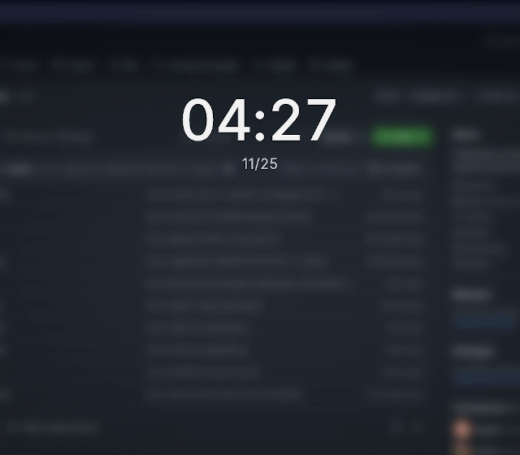

# kabi-lock

[English](README.md) | 日本語

Rust で開発された [sway](https://swaywm.org/) 向けの画面ロッカーです。
ロックすると画面が黒からデスクトップのぼかしスクリーンショットへフェードインし、時計を表示します。
キーを入力するたびに光の柱が立ち上がり、パスワード入力または YubiKey のタッチでロックを解除できます。


*sway でロックしてから解除する様子。*

## 特徴

- `ext-session-lock-v1` プロトコルを使用し、すべてのモニターのセッションをロックします。
- ロック直前に撮影したスクリーンショットにぼかしと周辺減光（ビネット）をかけ、黒画面からフェードイン表示します（デフォルト: 1.5 秒）。ロック解除時にはぼかしが徐々に消えて元の画面に戻ります。
- プライマリモニターに時計・日付・16 レーンの入力インジケーターを表示します。キーを押すたびに（Backspace を含む）、空いているレーンのいずれかに光の柱が立ち上がります。`Esc` および `Ctrl+U` は入力内容をクリアし、光の柱は表示しません。
- `Enter` を押すと鍵のアイコンが表示されます。認証に成功すると鍵が開き、失敗すると左右に震えます。
- パスワード認証には PAM を使用します。パスワード入力と並行して、YubiKey のタッチ（`pam_u2f`）によるロック解除も可能です。
- KeePassXC 連携（任意）: 画面ロック前にデータベースをロックし、ロック解除後にデータベースのロック解除ダイアログを表示するよう要求します。
- ロック中のモニターの着脱（ホットプラグ）に対応しています。新しく接続されたモニターにもロック画面（黒画面）が表示されます。
- GPU が利用できない環境でも、無地の黒画面で安全にロックします。
- TOML 形式で設定可能で、すべての項目は省略できます。



*キー入力で光の柱が立ち上がり、パスワードを間違えると鍵アイコンが震えます。*

## 動作要件

- `ext-session-lock-v1` に対応した Wayland コンポジター。sway で開発および動作確認を行っています（sway 1.8 以降で対応）。
- 任意: `wlr-screencopy-unstable-v1`（sway で対応）。スクリーンショット背景の取得に使用します。非対応の場合は黒背景になり（警告ログを出力）、ロック機能自体には影響しません。
- EGL および OpenGL ES 3 に対応した GPU ドライバー（Mesa など）。利用できない場合は黒画面でロックを行います。
- PAM、libxkbcommon、libwayland。
- `auth` と `account` の両方のエントリを含む `/etc/pam.d/kabi-lock` サービスファイル（Arch Linux パッケージでは自動的にインストールされます。[インストール](#インストール)を参照）。`auth.pam_service` で指定された PAM サービスファイルが `/etc/pam.d` と `/usr/lib/pam.d` のどちらにも存在しない場合、kabi-lock はロックを実行しません。
- 任意: sway の IPC ソケット（`SWAYSOCK`。sway が子プロセスに自動設定します）。ロック開始時にフォーカスされていたモニターの特定に使用します。取得できない場合は最初のモニターを使用します。
- 任意: fontconfig。Arch Linux パッケージでは依存関係としてインストールされます（ソースビルド時は任意）。
  `fc-list` で `appearance.font` に指定されたフォントを検索し、`fc-match` で現在の時刻ロケールにおける日付表示用のフォールバックフォントを検索します。これらの処理のタイムアウトは最大約 1 秒です。
  fontconfig がない場合やタイムアウトした場合は内蔵の Inter フォントが使用されるため、ラテン文字以外の曜日や月名が豆腐（空の四角）になることがあります。
- 任意: [`pam_u2f`](https://developers.yubico.com/pam-u2f/)（YubiKey によるロック解除に使用）。
- 任意: Secret Service 連携を有効化した KeePassXC（KeePassXC 連携機能に使用）。
- ビルド要件: Rust 1.95 以降（egui 0.37 の要件）、`git`、`clang`（`pam-sys` クレートが bindgen を実行するために必要）。

## インストール

### Arch Linux

```sh
mkdir kabi-lock-build && cd kabi-lock-build
curl -O https://raw.githubusercontent.com/y1wtt/kabi-lock/main/packaging/arch/PKGBUILD
makepkg -si
```

`main` ブランチの最新版をビルドし、バイナリ、`/etc/pam.d/kabi-lock`、ライセンス、ドキュメント、および `/usr/share/kabi-lock/` 配下のサンプルファイルをインストールします。

### ソースからビルド

```sh
git clone https://github.com/y1wtt/kabi-lock.git
cd kabi-lock
cargo build --release --locked
sudo install -Dm755 target/release/kabi-lock /usr/local/bin/kabi-lock
sudo install -Dm644 packaging/pam.d/kabi-lock /etc/pam.d/kabi-lock
```

フォント（Inter）はバイナリに組み込まれています。PAM サービスファイルは必須であり、`auth` と `account` の両方の行が必要です（[パスワード](#パスワード)を参照）。`/etc/pam.d/kabi-lock` が存在しない場合、kabi-lock はロックを開始しません。また、`auth` 行のみのファイルではすべてのパスワード認証が失敗します。自分自身を締め出さないよう、実行前に必ず作成してください。

手動で配置した `/etc/pam.d/kabi-lock` はパッケージ管理下にないため、後から Arch Linux パッケージをインストールする際は事前に削除してください。削除しないと `pacman -U` が `"exists in filesystem"` エラーで失敗します。

sway の `PATH` に `kabi-lock` が含まれていない場合は、キーバインド設定にフルパスを指定してください。

## 使い方

sway の設定ファイルにキーバインドを追加します（`contrib/sway/kabi-lock.conf` を参照）:

```
bindsym $mod+l exec kabi-lock
```

sway のデフォルト設定では `$mod+l` が「右のウィンドウへフォーカス」に割り当てられているため、どちらかのキーを変更してください。
設定後、`$mod+l` を押すとロックがかかります。パスワードを入力して `Enter` を押すか、YubiKey にタッチして解除します。

| キー | 動作 |
|---|---|
| `Enter` | パスワードを検証する |
| `Backspace` | 1 文字削除する |
| `Esc`、`Ctrl+U` | 入力内容をすべて消去する |

`kabi-lock` は引数なしで起動します。利用可能なオプションは `--help` と `--version` のみです。
ログは標準エラー出力に出ます。デフォルトのログレベルは `warn` で、`RUST_LOG=debug` を指定すると詳細なログが出力されます。
ログメッセージにパスワードやその文字数が含まれることはありません。

| 終了コード | 意味 |
|---|---|
| `0` | ロックを解除し、正常終了した |
| `1` | ロックに失敗した（`ext-session-lock-v1` 非対応、ロック要求の拒否、Wayland への接続失敗、PAM サービスファイルの不在、ユーザー名の取得失敗）、またはコンポジター側でロックが強制終了された（`"the compositor ended the lock"`） |
| `2` | コマンドライン引数が不正 |

実際のセッションをロックせずに動作を試すには、ネスト（入れ子）状態の sway を起動してその中で実行します（`WLR_BACKENDS=wayland sway -c nested.conf` とし、`nested.conf` に `exec kabi-lock && swaymsg exit` と記述します）。ロックを解除すると `kabi-lock` はステータス `0` で終了し、ネストされた sway も自動的に終了します。
ロックに失敗した場合はウィンドウが開いたままになるため、手動で閉じてください。

アイドル検知やサスペンド時の自動ロック機能は kabi-lock 自体には含まれていません。`kabi-lock` はロックが解除されるまでフォアグラウンドで動作し続けるため、`swayidle -w` の `before-sleep` フックから起動しないでください。
`-w` オプションを付けると `swayidle` は `kabi-lock` が終了するまで待機しようとしますが、logind がサスペンドを遅延させる時間はわずか（`InhibitDelayMaxSec`、デフォルト 5 秒）であるため、画面がロックされる前にサスペンドへ移行してしまいます。そのため、サスペンド時のロックには対応していません。`-w` なし（`swayidle before-sleep kabi-lock`）の場合は `swayidle` が完了を待たないため、スリープ突入時点で画面ロックが完了していない可能性があります。一方、アイドルタイムアウトによるロックには問題なく使用できます。すでにロック中の場合に多重起動しないよう、以下のように記述してください:

```sh
swayidle timeout 300 'pgrep -x kabi-lock || kabi-lock'
```

## 設定

設定ファイルは `$XDG_CONFIG_HOME/kabi-lock/config.toml` または `~/.config/kabi-lock/config.toml` に配置します。
すべての設定項目とデフォルト値を記載したサンプルは [`docs/config.example.toml`](docs/config.example.toml)（インストール後は `/usr/share/kabi-lock/config.example.toml`）にあります。

すべてのキーは省略可能です。未知のキーは警告を出力して無視されます。設定ファイルが存在しない場合は警告なしでデフォルト値を使用します。ファイルが読み取れない場合や構文エラーがある場合は、警告を出力したうえでファイル全体を無視し、デフォルト値を使用します。設定ファイルの不備によってロックが妨げられることはありません。唯一の例外として、`auth.pam_service` で指定された PAM サービスファイルが存在しない場合のみ、kabi-lock はロックを実行しません（終了コード `1`）。

| キー | デフォルト値 | 説明 |
|---|---|---|
| `display.primary` | `[]` | 時計・日付・入力インジケーター・鍵アイコンを表示するモニター。リストの先頭から順に一致するものを探します（詳細は後述） |
| `appearance.fade_in_ms` | `1500` | 黒画面からぼかし背景へフェードインする時間（ミリ秒） |
| `appearance.blur` | `7` | ぼかしの強さ。スクリーンショットのピクセル単位での 5 パス・ボックスブラー半径（`0.5`〜`50` の範囲にクランプされます。負の値や NaN の場合は `7`） |
| `appearance.date_format` | `"%m/%d"` | 時計の下に表示する日付のフォーマット（chrono の `strftime` 形式）。ロケール名は `LC_ALL`、`LC_TIME`、`LANG` の順で参照します。不正な書式の場合はデフォルト値にフォールバックします |
| `appearance.font` | `"Inter"` | 時計と日付のフォントファミリー。fontconfig（`fc-list`）で検索し、時計にはウェイト `500`、日付には `400` に最も近いものを使用します。見つからない・読み込めない場合、または fontconfig がない・タイムアウト（約 1 秒）した場合は内蔵の Inter を使用します |
| `appearance.unlock_open_ms` | `800` | ロック解除時、鍵アイコンが開くまでのアニメーション時間（ミリ秒）。ぼかしは `unlock_open_ms * 9/8`（デフォルトでは `900` ms）の時点から晴れ始めます。`0` で即時完了。上限は `5000` |
| `appearance.unlock_reveal_ms` | `700` | ロック解除時、ぼかしが完全に晴れてオーバーレイ表示が消えるまでの時間（ミリ秒）。この経過後にロックが解除されます（デフォルトでは解除開始から `1600` ms 後）。`0` で即時完了。上限は `5000` |
| `input.pillar_fade_ms` | `900` | 光の柱 1 本がフェードアウトするまでの時間（ミリ秒。上限 `10000`） |
| `input.pillar_width` | `32` | 光の柱の幅（px、1920x1080 基準。上限 `1920`） |
| `input.band_width` | `768` | 入力インジケーター全体の幅（px、1920x1080 基準。上限 `1920`） |
| `auth.pam_service` | `"kabi-lock"` | パスワード認証に使用する PAM サービス名 |
| `auth.u2f.enabled` | `true` | YubiKey のタッチによるロック解除を有効にするか |
| `auth.u2f.pam_service` | `"kabi-lock-u2f"` | YubiKey 認証に使用する PAM サービス名 |
| `keepassxc.lock_before` | `true` | 画面ロック前に KeePassXC のデータベースをロックするか |
| `keepassxc.unlock_after` | `true` | 画面ロック解除後に KeePassXC のデータベース解除を要求するか |

光の柱のレーン数は `floor((band_width + 16) / (pillar_width + 16))` を切り捨てたもので、最小値は `1` です。
デフォルト設定では `16` レーンになります。柱同士の間隔は `16` px です。

### 時計を表示するモニターの選択

`display.primary` には、出力名またはモニターの説明文をリストで指定します。接続中のモニターと最初に一致した項目が採用されます。
出力名（`"DP-10"` など）のほか、sway が `make model serial (DP-10)` の形式で出力する説明文（または末尾の ` (DP-10)` を除いた文字列）も指定できます。
各モニターの情報は `swaymsg -t get_outputs` で確認できます。

```toml
[display]
primary = ["DP-10", "LG Electronics LG ULTRAWIDE 311NTDV3Z418"]
```

リストのいずれにも一致しない場合は、ロック開始時にフォーカスされていたモニター（`SWAYSOCK` 経由で sway の IPC に短いタイムアウト付きで問い合わせて取得）を使い、それも特定できない場合は最初のモニターを使います。
プライマリ以外のモニターには、ぼかした背景だけを表示します。

## 認証

### パスワード

パスワード認証には `auth.pam_service` で指定された PAM サービスを使用します。パッケージに含まれる
`/etc/pam.d/kabi-lock`（ソースでは `packaging/pam.d/kabi-lock`）は、`login` の設定を読み込みます:

```
auth       include      login
account    include      login
```

この 2 行はどちらも必須です。kabi-lock はパスワード検証の成功後に `pam_acct_mgmt` を呼び出しますが、
`account` エントリがないサービスでは PAM がこの呼び出しを拒否（`PAM_PERM_DENIED`）するため、
`auth` 行だけでは正しいパスワードを入力してもすべて認証に失敗します。ファイルを独自のものに置き換える場合も、`account` の行は必ず残してください。

つまり、ロック画面の認証には通常のログインと同じ方針（`pam_faillock` など）に従います。パスワードを何度も間違えないよう注意してください。`login` の設定で数回の失敗によりアカウントがロックされるようになっている場合、kabi-lock でも同じことが起きます。また、`login` に含まれるモジュール（設定されている場合は `pam_u2f` など）は、すべてパスワード認証時にも評価されます。別のポリシーを適用したい場合は `/etc/pam.d/kabi-lock` を編集してください（パッケージ更新時も `pacman` によって編集内容は保持されます）。

### YubiKey

画面がロックされている間、kabi-lock はヘルパープロセス（自分自身をサブプロセスとして起動）を使って PAM サービス `auth.u2f.pam_service` の認証を待機します。タッチされないなどの理由で認証が失敗した場合は、1 秒後に新しいヘルパープロセスを再起動します。タッチが認識されると、パスワードを入力している途中であっても即座にロックが解除されます。ロック解除時、実行中のヘルパープロセスは停止されます。

**注意:** このサービスには `pam_u2f` のみを設定してください（サンプルファイルには `pam_permit` の `account` 行も含まれていますが、これは問題ありません）。特に以下の点に注意してください。

- `pam_u2f` の行に `nouserok` も `alwaysok` も付けないでください。これらを付けると、鍵ファイルが存在しない、または鍵を登録していないユーザーの場合に、YubiKey に触れなくても誰でもロックを解除できてしまいます。
- ユーザー入力を求めないでください。PIN 要求（`pinverification`）、`interactive`（「press ENTER」のプロンプト）、パスワード認証モジュール（`pam_unix`、`system-auth`、`login` など）を含めないでください。kabi-lock はこれらのプロンプトに一切応答しません。PAM サービスが入力を要求した場合、kabi-lock はそのロックセッション中の YubiKey 認証を中止し（失敗回数が蓄積しないよう再試行もしません）、パスワードで解除するしかなくなります。
- `pam_faillock` も、ほかの設定の `include` も入れないでください。kabi-lock は鍵がタッチされるまで失敗するたびに 1 秒後に確認をやり直すので、そうしたモジュールは毎秒失敗を数え、アカウントをロックしてしまうことがあります。

認証はタッチのみで行い、PIN は使用しません。

`authfile` のパスはユーザー環境によって異なるため、パッケージにはこのサービスファイルは含まれていません。
サンプルの `contrib/pam.d/kabi-lock-u2f`（インストール後は `/usr/share/kabi-lock/pam.d/kabi-lock-u2f`）をコピーして使用してください:

```sh
sudo cp /usr/share/kabi-lock/pam.d/kabi-lock-u2f /etc/pam.d/kabi-lock-u2f
# その後、鍵を登録した場所に合わせて authfile= を修正してください（pamu2fcfg を参照）
```

`auth.u2f.pam_service` に既存の PAM サービス（例: `"u2f-touch"`）を指定することも可能です（上記の注意事項を守っているか確かめてください）。指定されたサービスファイルが `/etc/pam.d` にも `/usr/lib/pam.d` のどちらにもなければ、kabi-lock はタッチ待機を始めず、警告ログを出力します。
`auth.u2f.enabled = false` にすると無効になります。

### KeePassXC

- 画面ロック前、kabi-lock は D-Bus 経由で KeePassXC の `lockAllDatabases` を呼び出します（完了は待機しません）。その後、最大 2 秒間 Secret Service を確かめ、まだ解除されたままのコレクションがあればデスクトップ通知を出します。どちらの場合もロックは進みます。KeePassXC が起動していなければ何もしません。
- 画面ロック解除後、ロックされているコレクションの解除を Secret Service 経由で要求し、KeePassXC にロック解除ダイアログを表示させます。

`keepassxc.lock_before = false` と `keepassxc.unlock_after = false` を設定すると無効化できます。

## セキュリティについて

- kabi-lock は個人開発のプロジェクトであり、第三者によるセキュリティ監査は受けていません。利用する前にこの節を読んでください。
- **付属の PAM サンプル設定では、YubiKey に触れるだけで画面が解除されます**（PIN もパスワードもなし）。鍵を挿したままなら、机に近づける人は誰でも解除できます。席を離れるときは鍵を抜くか、`auth.u2f.enabled = false` に設定してください（ここでは PIN は使えません。YubiKey 用ヘルパープロセスは PAM からのどの入力要求も断ります）。
- ロック機構には `ext-session-lock-v1` です。セッションのロックは sway 自身が保ち、ロッカーが落ちると無地の赤い画面を表示します。kabi-lock が異常終了したら、もう一度起動して解除してください（例えば TTY から、`WAYLAND_DISPLAY` と `XDG_RUNTIME_DIR` を sway のセッションのものにして）。
- スクリーンショットはメモリーにだけ置き、ディスクには書きません。ただし、ぼかし処理は見た目の効果で完全な黒塗りではないため、`blur` の値が小さいと大きな文字などは判読できる場合があります。気になる場合は `appearance.blur` の値を上げてください。
- パスワードはログに出しません。パスワード用バッファは使った後にできる限りゼロクリアしますが、PAM やそのライブラリが持つ写しは kabi-lock の手が届きません。
- kabi-lock はテキストコンソールへの切り替え（`Ctrl+Alt+F2` など）を止めません。これはシステム側の設定で決まります。脅威モデルに必要なら、コンソールをロックするか、VT の切り替えを無効にしてください。
- 間違ったパスワードはお使いの PAM の設定を通るので、アカウントがロックされることがあります（`pam_faillock`）。YubiKey のサービスは失敗するたびに 1 秒後にやり直すので、`nouserok` も `alwaysok` も付けない `pam_u2f` だけにしてください。そこに `pam_faillock` やパスワードのモジュールがあると失敗が積み上がり、その 2 つのオプションがあると誰でも通れてしまいます。
- `/etc/pam.d/kabi-lock` には `auth` と `account` の両方のエントリが要ります。kabi-lock はパスワードの確認の後に `pam_acct_mgmt` を呼び、`account` ルールが定義されていないサービスでは PAM がそれを失敗させます（そのため解除が決して成功しません）。ファイルを置き換えるときも `account` の行は残してください。設定した PAM サービスのファイルがないとき、kabi-lock はロックを取りません。成功しようのない確認の向こうに締め出されることがないようにするためです。
- 設定ファイルの破損、GPU の利用不可、スクリーンショット取得の失敗などが発生しても、ロックは続けます。それらで変わるのは画面の見た目だけです。

## 開発

```sh
cargo test                  # 単体テスト（Wayland 環境は要りません）
cargo build --release --locked
```

本物のセッションをロックして試さないでください。「[使い方](#使い方)」にあるように、入れ子の sway を使ってください。
ログは `RUST_LOG` で調節します。

## ライセンス

kabi-lock は [BSD 3-Clause License](LICENSE) で公開しています。
バイナリに組み込んだ [Inter](https://rsms.me/inter/) フォントのライセンスは SIL Open Font License 1.1 です（`assets/fonts/LICENSE.txt`）。
