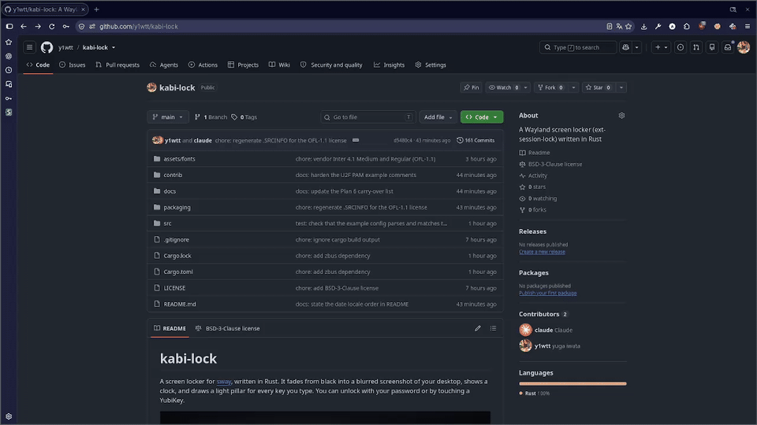
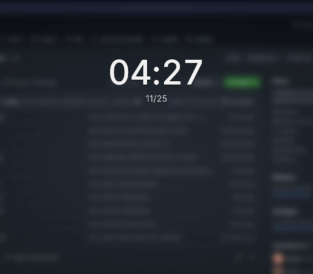

# kabi-lock

English | [日本語](README.ja.md)

A screen locker for [sway](https://swaywm.org/), written in Rust.
It fades from black into a blurred screenshot of your desktop, shows a clock, and draws a
light pillar for every key you type. You can unlock with your password or by touching a
YubiKey.



*Locking and then unlocking on sway.*

## Features

- Locks the session with `ext-session-lock-v1`, on every monitor.
- Background is a screenshot taken just before locking, blurred, darkened at the edges, and
  faded in from black (1.5 s by default). It clears up again when you unlock.
- Clock, date, and a 16-lane input bar on one monitor. Each key press raises a light pillar
  in a random free lane. Backspace does too; Esc and Ctrl+U clear the input without one.
- A padlock appears on Enter: it opens on success and shakes on failure.
- Password check through PAM. A YubiKey touch (`pam_u2f`) also unlocks, at the same time as
  the password prompt.
- Optional KeePassXC support: lock the databases before the screen locks, and ask for an unlock
  dialog after you unlock.
- Plug and unplug monitors while locked; new monitors get a locked (black) surface.
- If the GPU cannot be used, it still locks with a plain black screen.
- TOML configuration. Every setting is optional.



*Typing raises light pillars; a wrong password makes the padlock shake.*

## Requirements

- A Wayland compositor with `ext-session-lock-v1`. Developed and tested on sway
  (1.8 or newer has `ext-session-lock-v1`).
- Optional: `wlr-screencopy-unstable-v1` (sway has it), for the screenshot background. Without it
  the background is black (a warning is logged); locking is not affected.
- A GPU driver with EGL and OpenGL ES 3 (for example Mesa). Without it you get the black fallback.
- PAM, libxkbcommon, libwayland.
- A `/etc/pam.d/kabi-lock` service file with both `auth` and `account` lines (the Arch package
  installs one; see [Install](#install)). kabi-lock refuses to lock if the PAM service named by
  `auth.pam_service` has no file in `/etc/pam.d` or `/usr/lib/pam.d`.
- Optional: sway's IPC socket (`SWAYSOCK`, set by sway for its children), to find the monitor
  that was focused when the lock started. Without it the first monitor is used.
- Optional: fontconfig, which the Arch package installs as a dependency (optional when building from
  source). `fc-list` finds the font set by `appearance.font`; `fc-match` finds a fallback font for the
  date glyphs in the language of your time locale. kabi-lock waits at most about 1 second for them.
  Without fontconfig (or on a timeout) the clock and date use the built-in Inter, and non-Latin
  weekday or month names may show as empty boxes.
- Optional: [`pam_u2f`](https://developers.yubico.com/pam-u2f/) for YubiKey unlock.
- Optional: KeePassXC with its Secret Service integration enabled, for the KeePassXC features.
- To build: Rust 1.95 or newer (required by egui 0.37), `git`, and `clang` (the `pam-sys` crate runs bindgen).

## Install

### Arch Linux

```sh
mkdir kabi-lock-build && cd kabi-lock-build
curl -O https://raw.githubusercontent.com/y1wtt/kabi-lock/main/packaging/arch/PKGBUILD
makepkg -si
```

This builds the latest `main` and installs the binary, `/etc/pam.d/kabi-lock`, the licenses,
the documentation, and examples under `/usr/share/kabi-lock/`.

### From source

```sh
git clone https://github.com/y1wtt/kabi-lock.git
cd kabi-lock
cargo build --release --locked
sudo install -Dm755 target/release/kabi-lock /usr/local/bin/kabi-lock
sudo install -Dm644 packaging/pam.d/kabi-lock /etc/pam.d/kabi-lock
```

The font (Inter) is built into the binary. The PAM file is required, and it needs both its
`auth` and its `account` line (see [Password](#password)): without
`/etc/pam.d/kabi-lock` kabi-lock refuses to lock, and a file with `auth` alone rejects every
password. Create it before you test, so that you cannot lock yourself out.

A hand-copied `/etc/pam.d/kabi-lock` belongs to no package. If you install the Arch package later,
remove that file first, or `pacman -U` fails with "exists in filesystem".

If `kabi-lock` is not in the `PATH` that sway uses, write the full path in the key binding.

## Usage

Add a key binding to your sway config (see `contrib/sway/kabi-lock.conf`):

```
bindsym $mod+l exec kabi-lock
```

The default sway config already uses `$mod+l` for "focus right", so change one of the two.
Then press `$mod+l`. Type your password and press Enter, or touch your YubiKey.

| Key | Action |
|---|---|
| Enter | Check the password |
| Backspace | Delete one character |
| Esc, Ctrl+U | Clear the input |

Run `kabi-lock` with no arguments; the only options are `--help` and `--version`.
Logs go to stderr; the default level is `warn`, and `RUST_LOG=debug` shows more.
The messages never contain the password or its length.

| Exit code | Meaning |
|---|---|
| 0 | Unlocked, and exited normally |
| 1 | Could not lock (no `ext-session-lock-v1`, the request was refused, no Wayland connection, the PAM service file is missing, or the user name is unknown), or the compositor ended an established lock ("the compositor ended the lock") |
| 2 | Invalid arguments |

To try it without locking your real session, start a nested sway
(`WLR_BACKENDS=wayland sway -c nested.conf`, with `exec kabi-lock && swaymsg exit` in
`nested.conf`) and run it there. After you unlock, `kabi-lock` exits with 0 and the nested sway
exits too; if the lock fails the nested sway stays open, and you can close its window.

Idle and suspend integration is not part of kabi-lock. `kabi-lock` stays in the foreground
until you unlock, so do not run it from `swayidle -w` for `before-sleep`: with `-w` swayidle
blocks until `kabi-lock` exits, and logind only delays the suspend for a short time
(`InhibitDelayMaxSec`, 5 s by default), so the machine suspends anyway. Locking on suspend is not
supported: without `-w` (`swayidle before-sleep kabi-lock`) swayidle does not wait, so the screen
may not be locked yet when the machine sleeps. An idle timeout works that way. To avoid starting a
second instance while the screen is already locked, use
`swayidle timeout 300 'pgrep -x kabi-lock || kabi-lock'`.

## Configuration

Settings live in `$XDG_CONFIG_HOME/kabi-lock/config.toml`, or `~/.config/kabi-lock/config.toml`.
A full file with every key and its default is in
[`docs/config.example.toml`](docs/config.example.toml) (installed as
`/usr/share/kabi-lock/config.example.toml`).

All keys are optional. Unknown keys are ignored with a warning. A missing file silently gives the
defaults; an unreadable or invalid file logs a warning and gives the defaults (the whole file is
ignored). A broken configuration never stops the lock, with one exception: if the PAM service file
named by `auth.pam_service` does not exist, kabi-lock refuses to lock (exit code 1).

| Key | Default | Meaning |
|---|---|---|
| `display.primary` | `[]` | Monitors that get the clock, date, input bar and padlock, tried in order (see below) |
| `appearance.fade_in_ms` | `1500` | Fade from black to the blurred background, in ms |
| `appearance.blur` | `7` | Blur strength: radius of a 5-pass box blur in screenshot pixels (clamped to 0.5-50; negative or NaN becomes 7) |
| `appearance.date_format` | `"%m/%d"` | Date under the clock, chrono strftime format; names follow `LC_ALL`, then `LC_TIME`, then `LANG`. An invalid format falls back to the default |
| `appearance.font` | `"Inter"` | Font family for the clock and date. Looked up with fontconfig (`fc-list`): the weight nearest 500 for the clock and 400 for the date. If the family is not found or unreadable, or fontconfig is missing or too slow (about 1 s), the built-in Inter is used |
| `appearance.unlock_open_ms` | `800` | Unlock: time for the padlock to open, in ms. The blur starts clearing at `unlock_open_ms * 9/8` (900 with the default). 0 is instant; clamped to 5000 |
| `appearance.unlock_reveal_ms` | `700` | Unlock: time for the blur to clear and the overlays to fade out, in ms; the lock is released when it ends (1600 ms after the unlock with the defaults). 0 is instant; clamped to 5000 |
| `input.pillar_fade_ms` | `900` | Lifetime of one light pillar, in ms (clamped to 10000) |
| `input.pillar_width` | `32` | Pillar width in px (1920x1080 layout; clamped to 1920) |
| `input.band_width` | `768` | Input bar width in px (1920x1080 layout; clamped to 1920) |
| `auth.pam_service` | `"kabi-lock"` | PAM service for the password |
| `auth.u2f.enabled` | `true` | Also accept a YubiKey touch |
| `auth.u2f.pam_service` | `"kabi-lock-u2f"` | PAM service for the YubiKey |
| `keepassxc.lock_before` | `true` | Lock KeePassXC databases before locking the screen |
| `keepassxc.unlock_after` | `true` | Ask KeePassXC to unlock its databases after unlocking |

The number of pillar lanes is `(band_width + 16) / (pillar_width + 16)`, rounded down, and at least 1.
The defaults give 16 lanes. Pillars are 16 px apart.

### Choosing the monitor for the clock

`display.primary` is a list of names or descriptions. The first entry that equals a connected
monitor wins. An entry can be an output name such as `"DP-10"`, or the monitor description.
sway describes a monitor as `make model serial (DP-10)`; the text without the trailing
` (DP-10)` is accepted too. Run `swaymsg -t get_outputs` to see them.

```toml
[display]
primary = ["DP-10", "LG Electronics LG ULTRAWIDE 311NTDV3Z418"]
```

If nothing matches, the monitor that was focused when the lock started is used (asked from the
sway IPC through `SWAYSOCK`, with a short time limit), and if that is unknown, the first monitor.
Other monitors show only the blurred background.

## Authentication

### Password

The password is checked by the PAM service `auth.pam_service`. The packaged
`/etc/pam.d/kabi-lock` (`packaging/pam.d/kabi-lock` in the source tree) includes your `login` stack:

```
auth       include      login
account    include      login
```

Both lines are required, not decoration: after a successful password check kabi-lock
calls `pam_acct_mgmt`, and PAM fails that call (`PAM_PERM_DENIED`) for a service that has no
`account` lines, so with `auth` alone every correct password would be rejected.
If you replace the file, keep an `account` line.

So the lock screen follows your login policy, for example `pam_faillock`. Be careful with
repeated wrong passwords: if your login stack locks the account after a few failures, so will
kabi-lock. Every module in your `login` stack (such as `pam_u2f`, if your system uses it there)
takes part in the password check too. Edit `/etc/pam.d/kabi-lock` if you want a different policy;
pacman keeps your edits when you upgrade.

### YubiKey

While the screen is locked, kabi-lock checks the PAM service `auth.u2f.pam_service` in a helper
process (kabi-lock starts a copy of itself for this). If a try fails, for example because nothing
is touched, a new helper starts one second later. When a touch is accepted, the screen unlocks,
even while you are typing a password. The helper is stopped when the screen unlocks.

**Warning:** this service must contain `pam_u2f` only (the example also has a `pam_permit`
`account` line, which is harmless). In particular:

- No `nouserok` and no `alwaysok` on the `pam_u2f` line. With them, a missing key file or a user
  with no registered key would let anyone unlock the screen without touching a key.
- No prompts: no PIN (`pinverification`), no `interactive` (it asks "press ENTER"),
  and no password stack (`pam_unix`, `system-auth`, `login`, ...). kabi-lock answers none of them.
  If the service asks for any input, kabi-lock gives up on security-key unlock for that lock
  (it does not retry, to avoid piling up failures) and you must unlock with your password.
- No `pam_faillock` and no `include` of another stack: kabi-lock starts a new check one second after
  each failed one until a key is touched, so such modules would count a failure every second and
  can lock your account.

Touch-only, no PIN.

The package does not install this service because the `authfile` path differs per user.
Use the example `contrib/pam.d/kabi-lock-u2f` (installed as
`/usr/share/kabi-lock/pam.d/kabi-lock-u2f`):

```sh
sudo cp /usr/share/kabi-lock/pam.d/kabi-lock-u2f /etc/pam.d/kabi-lock-u2f
# then edit authfile= to match where your keys are registered (see pamu2fcfg)
```

You can also set `auth.u2f.pam_service` to a service you already have, for example `"u2f-touch"`
(check that it follows the rules above). If the service file exists neither in `/etc/pam.d`
nor in `/usr/lib/pam.d`, kabi-lock does not start the touch check and logs a warning.
Set `auth.u2f.enabled = false` to turn it off.

### KeePassXC

- Before the screen locks, kabi-lock calls `lockAllDatabases` on KeePassXC (D-Bus) and does not wait
  for it. It then checks the Secret Service for up to 2 seconds; if a collection is still unlocked,
  or the collections cannot be read so the lock cannot be confirmed, it shows a notification. The
  lock goes ahead either way. If KeePassXC is not running, nothing happens.
- After you unlock, it asks the Secret Service to unlock the collections that are locked, so
  KeePassXC shows its unlock dialog.

Turn these off with `keepassxc.lock_before = false` and `keepassxc.unlock_after = false`.

## Security notes

- kabi-lock is a personal project and has not been audited. Read this section before relying on it.
- **A YubiKey touch alone unlocks the screen** with the supplied PAM example (no PIN, no password).
  Anyone who can reach your desk while the key is plugged in can unlock it. Unplug the key when
  you leave, or set `auth.u2f.enabled = false`. (A PIN cannot be used here: the YubiKey helper
  refuses every PAM prompt.)
- The lock is `ext-session-lock-v1`: sway itself keeps the session locked and shows a plain
  red screen if the locker dies. If kabi-lock crashes, start it again to unlock (for example from
  a TTY with `WAYLAND_DISPLAY` and `XDG_RUNTIME_DIR` set to your sway session).
- The screenshot is kept only in memory and is never written to disk. The blur is a visual effect,
  not redaction: with a small `blur` value large text may still be readable. Raise `appearance.blur`
  if that matters to you.
- Passwords are never logged. The password buffer is wiped after use, on a best-effort basis; the
  copy that PAM and its libraries hold is outside kabi-lock's control.
- kabi-lock does not stop switching to a text console (Ctrl+Alt+F2 and the like), which is
  governed by your system. Lock the console or disable VT switching if your threat model needs it.
- Wrong passwords go through your PAM stack and can lock your account (`pam_faillock`).
  The YubiKey service is tried again one second after each failure, so it must be `pam_u2f` only,
  without `nouserok` or `alwaysok`: a `pam_faillock` or password module there would pile up
  failures, and those two options would let anyone in.
- `/etc/pam.d/kabi-lock` needs both its `auth` and its `account` line: kabi-lock calls
  `pam_acct_mgmt` after the password check, and PAM fails that for a service without `account`
  rules (so unlocking would never succeed). If you replace the file, keep an `account` line.
  kabi-lock refuses to lock when the configured PAM service file does not exist, so that you
  are never locked behind a check that cannot succeed.
- Locking continues even when the configuration is broken, the GPU cannot be used, or a
  screenshot fails; those only change how the screen looks.

## Development

```sh
cargo test                  # unit tests (no Wayland needed)
cargo build --release --locked
```

Do not test by locking your real session. Use a nested sway, as described under Usage.
Logs are controlled with `RUST_LOG`.

## License

kabi-lock is released under the [BSD 3-Clause License](LICENSE).
The [Inter](https://rsms.me/inter/) font built into the binary is licensed under the
SIL Open Font License 1.1 (`assets/fonts/LICENSE.txt`).
