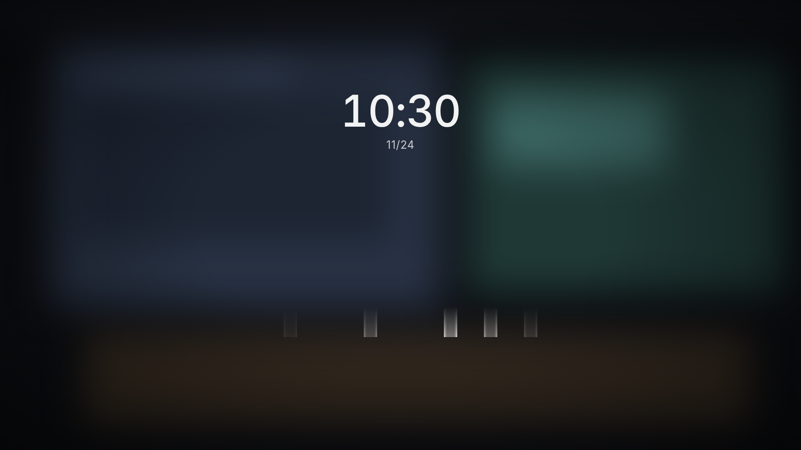
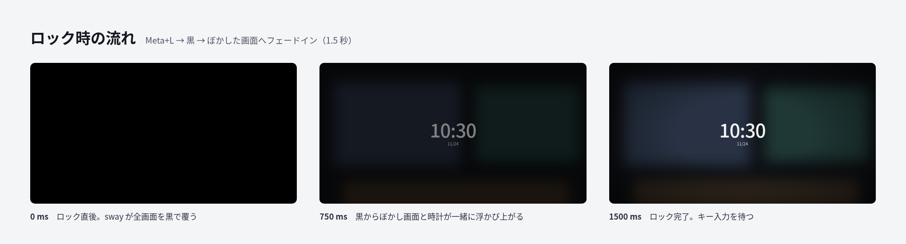
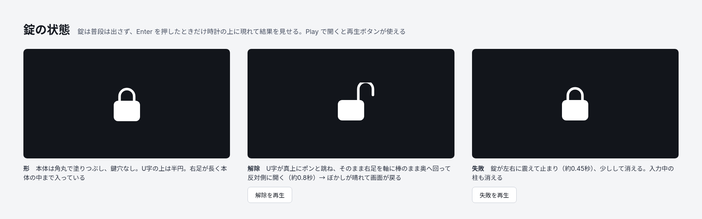
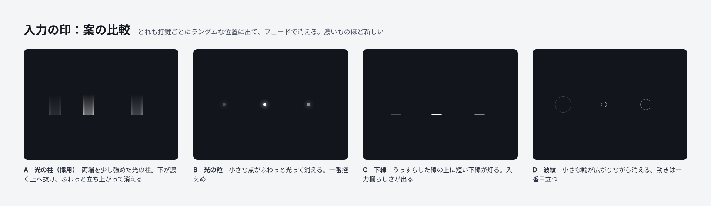

# kabi-lock のデザイン

デザインは Claude Design のキャンバスで作った。ここにはその書き出しと元データを置く。
数値の正は設計書（`docs/superpowers/specs/2026-11-24-kabi-lock-design.md` の 3 章）。

## 画像（`images/`）

| ファイル | 内容 |
|---|---|
| `lock-screen.png` | ロック画面（入力中）。1920x1080 |
| `lock-timeline.png` | ロック時の流れ（黒 → フェードイン 1.5 秒 → 入力待ち） |
| `padlock-states.png` | 錠の形と、解除・失敗の状態（解除は開き切った形） |
| `input-marks.png` | 入力の印の案の比較。A「光の柱」を採用 |

### ロック画面



### ロック時の流れ



### 錠の状態



### 入力の印



背景のデスクトップは、実際のスクリーンショットの代わりに、ぼかした四角を並べて表したもの。
アニメーション（光の柱、錠の解除と震え、フェード）は画像では静止しているので、動きは設計書 3 章を参照。

## 元データ（`source/`）

Claude Design のキャンバスの中身（各ボードの `.dc.html` と、配置を記した `canvas.json`）。
Claude Design の実行環境（`support.js`）の上で動く形式なので、ブラウザで直接開いても正しく表示されない。
デザインを直すときに、Claude Design へ取り込み直す元として使う。

| ファイル | ボード |
|---|---|
| `Main.dc.html` | ロック画面（入力中） |
| `Prototype.dc.html` | 試し打ちプロトタイプ（キー入力で光の柱、`kabi` + Enter で解除、それ以外は失敗） |
| `Timeline.dc.html` | ロック時の流れ |
| `States.dc.html` | 錠の状態（再生ボタンで解除・失敗の動きを再生） |
| `Marks.dc.html` | 入力の印の案の比較 |
| `canvas.json` | キャンバス上の配置とメモ |

## 画像の作り方

`source/` の `.dc.html` のうち、テンプレートの差し込み（`{{...}}`）を固定値に置き換えたものを
ヘッドレスの Chrome で撮った。

```bash
google-chrome-stable --headless=new --hide-scrollbars --virtual-time-budget=6000 \
  --window-size=1920,1080 --screenshot=lock-screen.png file:///path/to/Main.dc.html
```

置き換えた値:

- `Timeline.dc.html`: `{{fadeLabel}}` → `1.5 秒`、`{{midLabel}}` → `750 ms`、`{{endLabel}}` → `1500 ms`
- `States.dc.html`: `{{shackleD}}` → 開き切った U 字のパス
  `M62 26 V18 C62 12.48 57.52 8 52 8 C46.48 8 42 12.48 42 18 V40`、`{{shackleY}}` → `-9`、`{{failClass}}` → 空
